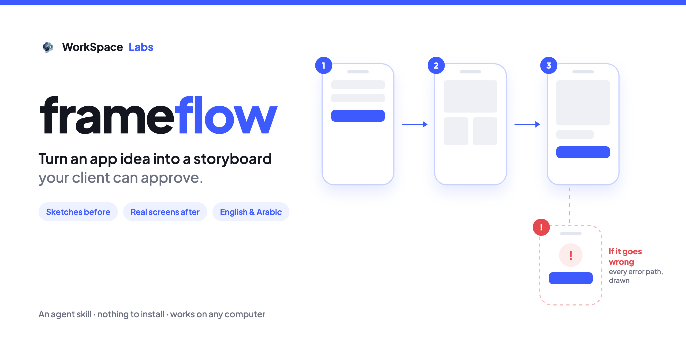

# frameflow



**Turn an app idea into a storyboard your client can approve.**

An agent skill that draws an app's **screens as a storyboard**: one screen a page, shown big, with a marker
where the user taps; beside it the screen's number and what the user sees and does; under it the story's
other screens. What happens when something goes wrong gets its own red page. The pages wear **the app's own
colours**. An approved design shows in every frame from the start; with no design yet, sketches before you
build and real screenshots after. The client approves it before a line of code is written.

The skill is the folder [`skills/frameflow/`](skills/frameflow/): its instructions,
[`SKILL.md`](skills/frameflow/SKILL.md), and a page template that draws the storyboard in any browser.
**Nothing to install.**

**Version 0.3.0** · 75 regression tests (including 3 optional native Mac checks) · [current and historical test evidence](TESTING.md)

---

## What you get

In your project's `docs/app-flow/`:

| File | What it is |
|---|---|
| `app-flow.md` | the storyboard as short, readable text: the master copy any agent can read and update |
| `storyboard.html` | the page that draws it (open it in Chrome, Edge or Safari) |
| `<Project> - App flow v1.pdf` | the PDF for the client: a cover, then one page per screen |
| `screenshots/` | approved screen designs from version 1 when available; real screens after building |

The PDF holds:

1. **A cover**: the app's first screen, its name, one line about it, **Draft for review** or **Approved**
   with the date, the stories with their pages, and who it is for.
2. **One page per screen**, story by story ("Signing in", "Ordering food"): the screen big, a marker where
   the user taps, its number, what the user **sees** and **does**, and the story's other screens underneath.
3. **A red page for each "if it goes wrong"**, right after its screen, with the way back.

The pages are A4 lying on its side, in the app's own background and button colour.

Four frames: **phone**, **tablet**, **desktop window** and **browser** (a website can also show its phone
version). English by default; **Arabic** turns the whole page right to left.

## How it works

1. The agent asks two things first: **what kind of project** it is, and **whether you have a workflow** for
   it (if you use [workflow-project](https://github.com/workspace-labs/workflow-project), it builds from it).
2. It **asks about the screens** in small rounds (who uses it, what they see first, what they do, what can
   go wrong), then **reads the plan back** until you say "yes, that's it".
3. It writes `app-flow.md` and copies the template; **the page draws itself**. If a line is wrong or a
   caption does not fit, the page refuses with numbered problems instead of a messy drawing.
4. It makes the PDF (with the Chrome or Edge you already have), or tells you the exact Print settings.
5. **The client approves**, or asks for changes: each round is a new version (v1, v2…).
6. **After building**, it swaps the sketches for real screenshots with their tap points, after warning you
   to use demo data.

## Install

The storyboard needs only a browser. The skill needs nothing else.

**Claude Code, Codex and other agents**, in one line:

```bash
npx skills add workspace-labs/frameflow -g
```

Or by hand, for Claude Code (macOS or Linux, Bash). The copy refuses an existing file, folder
or symlink; back up an existing installation before choosing to replace it:

```bash
git clone https://github.com/workspace-labs/frameflow.git
skill_root="$HOME/.claude/skills"
skill_target="$skill_root/frameflow"
if [ -e "$skill_target" ] || [ -L "$skill_target" ]; then
  printf '%s\n' "Already exists: $skill_target. Back it up before updating." >&2
  false
else
  mkdir -p "$skill_root" && cp -R frameflow/skills/frameflow "$skill_target"
fi
```

**Claude app (chat and Cowork)**: make the zip, then upload it in **Customize → Skills**.

```bash
cd frameflow
if [ -e dist/frameflow.zip ] || [ -L dist/frameflow.zip ]; then
  printf '%s\n' "Already exists: dist/frameflow.zip. Back it up before rebuilding." >&2
  false
else
  mkdir -p dist && (cd skills && zip -r -X ../dist/frameflow.zip frameflow -x '*.DS_Store')
fi
```

**GitHub Copilot, Cursor and ChatGPT**: where your tool supports agent skills, install the same folder.
Not tested yet.

Then start a fresh session and ask for an app flow. The agent asks its questions first, then hands over the
storyboard.

## Try it without an agent

Open [`skills/frameflow/assets/template/storyboard.html`](skills/frameflow/assets/template/storyboard.html)
in a browser. To see an example, paste the text of one of the files in
[`skills/frameflow/examples/`](skills/frameflow/examples/) between the two `app-flow` lines in that file, and
reload.

Follow the text-copy rules before pasting: no closing script tags in any capitalisation or spacing,
and no HTML comment openings (`<!--`). These can break the embedded copy before the reader runs.

## The text copy

```markdown
# Food Delivery App

- kind: phone
- stage: #f3f4f6
- accent: #f2541b
- version: 1

## Ordering food
From choosing a restaurant to the order confirmed.

1. Home: Sees nearby restaurants. Taps one. → 2
   shot: screenshots/1-1-home.png
   tap: 50%, 28% Taps a restaurant
2. Pay [form]: Sees the card form. Enters the card, taps "Pay now". → 3
   ! Card refused: Sees "Payment failed". Taps "Try again". → 2
3. Confirmed [done]: Sees the order number.
```

The full shape is in [`references/storyboard-format.md`](skills/frameflow/references/storyboard-format.md).

## How it was tested

The original 0.1.0 release had 64 automated tests, 8 planted bugs caught, and 4 rounds of independent
review that found 11 problems. The 0.2.1 repair added targeted parser, shell and native Mac regressions.
Version 0.3.0 redrew the pages and rewrote the layout tests for them; its new drawing has not had a second
review yet. Current results and the dated historical record are kept separately in [`TESTING.md`](TESTING.md).

## Limits

- Up to 12 stories and 24 screens a story; up to two "if it goes wrong" frames under a screen.
- English and Arabic.
- The page structure and type are fixed (Plus Jakarta Sans); the two colours are your app's. Your own name
  goes on the cover; one small "Made with frameflow · by WorkSpace Labs" line sits at the bottom of the last page.

## Working on frameflow

See [`AGENTS.md`](AGENTS.md). Tests: `node --test` (Node.js 18 or newer, for the tests only).

## Licence

MIT, see [`LICENSE`](LICENSE). The fonts (Plus Jakarta Sans, Noto Naskh Arabic) keep their SIL Open Font
License; see [`CREDITS.md`](CREDITS.md).
